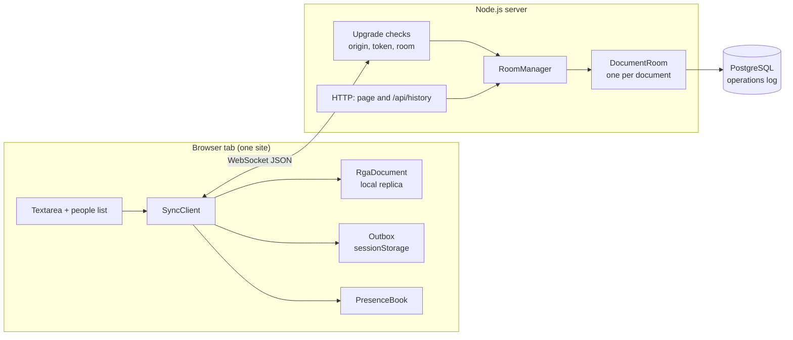
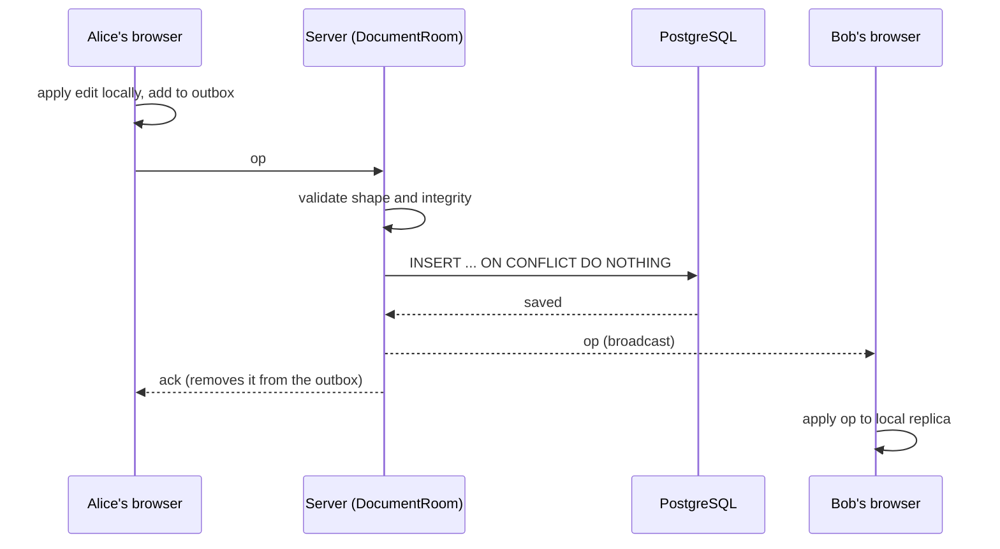
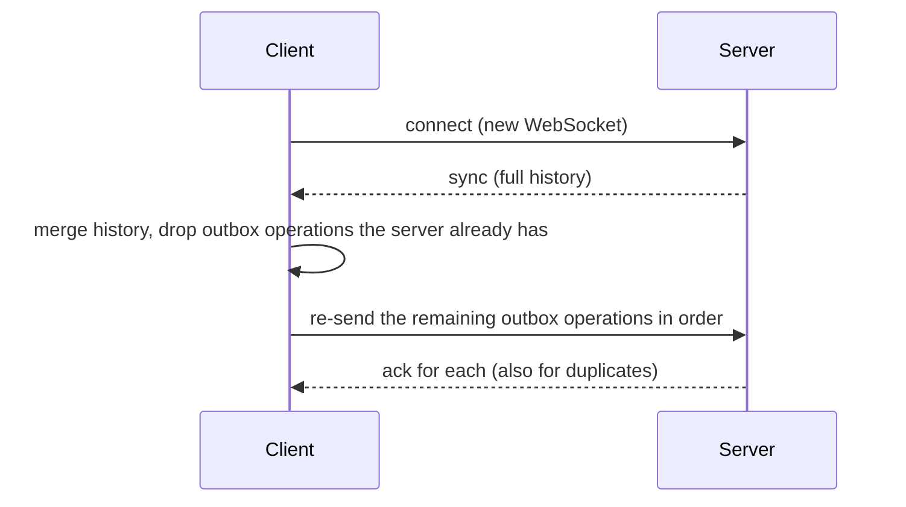
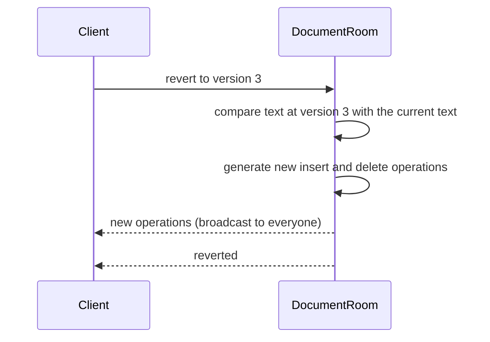

# Architecture

A real-time collaborative text editor backend. Every character has a unique ID, edits are
small *operations*, and a hand-written sequence CRDT (RGA) merges concurrent operations so
all replicas converge without a central referee.

## 1. System overview



## 2. Components

| Component | Files | Responsibility |
|---|---|---|
| IDs and clock | `src/crdt/id.js`, `lamport-clock.js` | unique, totally ordered character IDs `{counter, siteId}` |
| RGA document | `src/crdt/rga-document.js` | insert/delete, tombstones, causal buffering, idempotency, cursor anchors |
| History | `src/crdt/history.js` | rebuild the document after the first N operations |
| SyncClient | `src/client/sync-client.js` | local-first editing, outbox, acknowledgements, reconnect, presence |
| Client helpers | `src/client/*` | outbox, backoff, throttle, text diff, presence book, site ID |
| Protocol | `src/server/protocol.js` | validate and sanitize every incoming message |
| DocumentRoom | `src/server/document-room.js` | one document: ordered queue, save-then-broadcast, history, revert, presence |
| RoomManager | `src/server/room-manager.js` | rooms per document, created on first use, restored from the database |
| OperationStore | `src/server/operation-store.js` | append-only storage in PostgreSQL |
| Server | `src/server/server.js`, `api.js`, `static-files.js` | upgrade checks, per-connection rate limit, dispatch, HTTP |
| Safety | `auth.js`, `token-bucket.js`, `heartbeat.js` | token check, rate limiting, dead-connection detection |

## 3. Data model

**Character ID:** `{ counter, siteId }`, compared by counter, then by siteId. The counter comes
from a Lamport clock, so a character created after seeing another has a larger ID.

**Operations** (the only thing that travels or is stored):

```json
{ "type": "insert", "id": {"counter": 3, "siteId": "u-ab12"}, "parentId": {"counter": 2, "siteId": "u-ab12"}, "value": "x" }
{ "type": "delete", "targetId": {"counter": 3, "siteId": "u-ab12"} }
```

**Document:** an ordered list of nodes `{ id, value, deleted }`. Deleted characters stay as
*tombstones* so later operations can still refer to them. Visible text is the list without
tombstones. Inserting puts a node right after its parent, skipping every node with a bigger ID.

**Cursor anchors:** a cursor is the ID of the character just before it (or the root), so it
follows other people's edits. See `docs/adr/0004-presence-is-ephemeral.md`.

## 4. Key flows

**Typing**



**Reconnect after being offline**



**Revert to an earlier version**



## 5. Guarantees

| Guarantee | How |
|---|---|
| Replicas converge | deterministic RGA integration, total order of IDs, idempotency, causal buffering (`docs/CONVERGENCE.md`) |
| An acknowledged edit is durable | the server saves to PostgreSQL before acknowledging or broadcasting |
| No edit is lost across a disconnect | outbox re-sends everything not acknowledged |
| No edit is applied twice | `UNIQUE (document_id, op_key)` plus an in-memory duplicate check |
| History is immutable | append-only log; revert adds new operations |

**Not guaranteed:** presence is best-effort and may be briefly stale; there is no per-user identity
(one shared access token); ordering across different documents.

## 6. Failure modes

| Failure | Behaviour |
|---|---|
| Client offline | edits continue locally; the outbox re-sends after reconnecting (backoff 0.5 s to 8 s with jitter) |
| Connection dies silently | heartbeat terminates it; peers see the person leave |
| Duplicate or reordered delivery | duplicates ignored; operations wait for their parent (causal buffering) |
| Server restarts | history is restored from PostgreSQL; clients reconnect and re-sync |
| Database unavailable | the save fails, nothing is broadcast, the client keeps the edit in its outbox and gets a generic error |
| Flooding | token bucket per connection closes the connection (1008); the outbox re-sends after reconnecting |
| Forged operation | shape validation, unknown parent/target rejected, id must be newer than its parent |
| Another website opens a WebSocket | `Origin` check on upgrade |

## 7. Security model

Layered defences: message size cap (1 MiB), strict validation and sanitization, integrity checks,
rate limiting, client and document caps, optional shared token compared in constant time,
`Origin` check, document ID pattern, and names rendered with `textContent`. The token proves
knowledge of a shared secret, not identity, and travels in the URL, so real use needs HTTPS.

## 8. Testing strategy

| Layer | Examples |
|---|---|
| Unit | IDs, clock, RGA, outbox, token bucket, protocol, stats |
| Convergence | every delivery order of a 6-operation scenario (720), duplicates, seeded random simulations |
| End to end | real server and real clients over WebSockets, history API, revert, presence |
| Chaos | random disconnects and offline periods; no lost or duplicated operation, identical replicas |
| Performance | latency benchmark with percentiles; a test asserts p95 under one second |

## 9. Limits and how it could scale

Single process; rooms stay in memory once opened; every reconnect receives the full history;
viewing a version replays the log. Possible next steps (not built): snapshots, version vectors
(send only what the other side lacks), sticky routing by document ID, a publish/subscribe layer
(for example Redis) to run several server instances, tombstone garbage collection.

## 10. Glossary

**Site**: one replica (each page load). **Operation**: an insert or delete. **Tombstone**: a deleted
character kept as a marker. **Idempotent**: applying twice equals applying once. **Causal delivery**:
an operation is applied only after the operations it depends on. **Ack**: the server confirms an
operation is saved. **Outbox**: the client's list of unacknowledged operations. **Anchor**: a
character ID used as a cursor position.